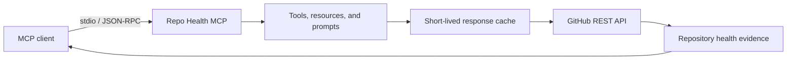

<!-- markdownlint-disable MD013 -->

# Repo Health MCP

Repo Health MCP is a read-only Model Context Protocol server that helps an MCP client inspect a GitHub repository, explain its maintenance health, and assess how approachable it is for new contributors.

Instead of returning an unexplained score, the server exposes the evidence behind its assessment: recent activity, releases, issue maintenance, contributor participation, documentation, licensing, and community files.

> **Project status:** feature-complete initial release with seven tools, three resource templates, two reusable prompts, automated tests, and continuous integration.

## Capabilities

### Tools

- `inspect_repository` — collect repository metadata, languages, and community-profile information.
- `analyze_project_health` — calculate a transparent health score with category-level explanations.
- `find_good_first_issues` — surface beginner-friendly contribution opportunities.
- `summarize_recent_releases` — summarize release cadence and recent changes.
- `analyze_contributor_activity` — describe recent contributor participation.
- `compare_repositories` — compare health signals across repositories.
- `check_repository_readiness` — identify missing documentation and community files.

### Resources

- `repo-health://{owner}/{repository}` — complete health report as JSON.
- `repo-health://{owner}/{repository}/releases` — five recent stable releases and cadence.
- `repo-health://{owner}/{repository}/contributors` — 90-day contributor activity.

### Prompts

- `evaluate_project` — produce an evidence-based audit with an overall, maintenance, community, or contributor focus.
- `compare_project_health` — compare two projects with the same health model and explain the trade-offs.

## How it works



The server runs locally over stdio. It sends GitHub REST requests using an optional personal access token, converts the responses into typed evidence, and returns structured MCP results. Standard output is reserved exclusively for MCP protocol traffic; diagnostics are written to standard error.

## Requirements

- Node.js 22 or newer
- npm
- An MCP-compatible client or the MCP Inspector
- Optional GitHub token for higher API limits and access to repositories your token can read

## Installation

```bash
git clone https://github.com/ronitpahuja08/repo-health-mcp.git
cd repo-health-mcp
npm install
npm run build
```

## Configuration

The server works with public repositories without authentication. Set `GITHUB_TOKEN` to use authenticated GitHub API limits.

PowerShell:

```powershell
$env:GITHUB_TOKEN = "your-token"
npm start
```

macOS or Linux:

```bash
GITHUB_TOKEN="your-token" npm start
```

GitHub Enterprise Server users can also set `GITHUB_API_BASE_URL`:

```text
GITHUB_API_BASE_URL=https://github.example.com/api/v3
```

Never commit a token. Local `.env` files are ignored by Git; `.env.example` only documents supported variables.

## MCP client configuration

Build the project first, then point an MCP client at the generated entry point using an absolute path:

```json
{
  "mcpServers": {
    "repo-health": {
      "command": "node",
      "args": ["C:/absolute/path/to/repo-health-mcp/build/index.js"]
    }
  }
}
```

## Development

```bash
npm test
npm run typecheck
npm run build
```

Use `npm run test:watch` during development. The project uses strict TypeScript settings, including unchecked-index and exact-optional-property checks. GitHub responses are represented by explicit interfaces, and API errors preserve rate-limit information for actionable MCP responses.

## MCP Inspector demo

Build the server before running the Inspector CLI examples:

```bash
npm run build
```

List the advertised tools and validate their schemas:

```bash
npx --yes @modelcontextprotocol/inspector --cli node build/index.js --method tools/list --strict
```

Run a health analysis against this repository:

```bash
npx --yes @modelcontextprotocol/inspector --cli node build/index.js --method tools/call --tool-name analyze_project_health --tool-args-json '{"owner":"ronitpahuja08","repository":"repo-health-mcp"}'
```

Check whether a repository is ready for outside contributors:

```bash
npx --yes @modelcontextprotocol/inspector --cli node build/index.js --method tools/call --tool-name check_repository_readiness --tool-args-json '{"owner":"modelcontextprotocol","repository":"typescript-sdk"}'
```

Discover and read resources:

```bash
npx --yes @modelcontextprotocol/inspector --cli node build/index.js --method resources/templates/list
npx --yes @modelcontextprotocol/inspector --cli node build/index.js --method resources/read --uri "repo-health://ronitpahuja08/repo-health-mcp"
```

Render a reusable project-evaluation prompt:

```bash
npx --yes @modelcontextprotocol/inspector --cli node build/index.js --method prompts/get --prompt-name evaluate_project --prompt-args owner=ronitpahuja08 repository=repo-health-mcp focus=community
```

The Inspector web interface is also available:

```bash
npx --yes @modelcontextprotocol/inspector node build/index.js
```

## Troubleshooting

### `GITHUB_TOKEN` is ignored

Environment variables must be set in the process that launches the server. Restart the MCP client after changing its configuration. The token needs read access to any private repository being inspected; public-only use does not require a token.

### GitHub returns `403` or `429`

The server preserves GitHub's rate-limit details in its error. Wait until the reported reset time or configure `GITHUB_TOKEN` for a higher authenticated allowance. Repeated identical reads are cached briefly to avoid unnecessary API requests.

### The client reports invalid JSON or a closed stdio connection

Run `npm run build` again and confirm the client points to the absolute `build/index.js` path. Do not add normal logging to standard output: stdout is reserved for MCP messages. Send diagnostics to `console.error` instead.

### A Windows path does not launch

Use an absolute path with forward slashes in JSON, for example `C:/projects/repo-health-mcp/build/index.js`. Alternatively, escape every backslash as `\\`.

### Inspector cannot find a tool, resource, or prompt

Rebuild before launching the Inspector. Then use `tools/list`, `resources/templates/list`, or `prompts/list` to confirm what the running process advertises. An already-running MCP process does not automatically reload source changes.

## Current structure

```text
src/
├── analysis/          # Explainable health scoring
├── cache/             # Typed TTL response cache
├── config.ts          # Environment and GitHub authentication configuration
├── github/
│   ├── client.ts      # Typed GitHub REST client
│   ├── errors.ts      # API and rate-limit errors
│   └── types.ts       # GitHub response contracts
├── index.ts           # stdio process entry point
├── prompts/           # Reusable MCP evaluation workflows
├── resources/         # Dynamic health and activity resources
├── server.ts          # MCP server factory
└── tools/             # Repository inspection and analysis tools
tests/                 # Unit, client, and MCP capability tests
```

## Design principles

- **Explainable:** every score should include the evidence and weighting behind it.
- **Read-only:** analysis must not modify the inspected repository.
- **Secure by default:** secrets stay in environment variables and error messages never expose tokens.
- **Rate-limit aware:** callers receive useful reset information instead of generic failures.
- **Testable:** network access is injectable so API behavior can be verified with deterministic fixtures.

## Roadmap

- [x] Strict TypeScript project and stdio transport
- [x] Optional GitHub authentication
- [x] Typed GitHub REST client
- [x] API error and rate-limit handling
- [x] TTL response cache
- [x] Repository inspection tool
- [x] Explainable health analysis
- [x] Contribution, release, comparison, and readiness tools
- [x] Dynamic resources and reusable prompts
- [x] Automated tests and continuous integration
- [x] MCP Inspector demo and troubleshooting guide
