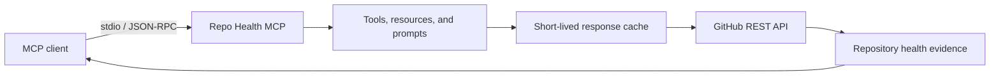

# Repo Health MCP

Repo Health MCP is a read-only Model Context Protocol server that helps an MCP client inspect a GitHub repository, explain its maintenance health, and assess how approachable it is for new contributors.

Instead of returning an unexplained score, the finished server will expose the evidence behind its assessment: recent activity, releases, issue maintenance, contributor participation, documentation, licensing, and community files.

> **Project status:** active development. The MCP transport, configuration layer, typed GitHub client, authentication support, and rate-limit handling are implemented. Repository analysis tools are being added incrementally.

## Planned capabilities

### Tools

- `inspect_repository` — collect repository metadata, languages, and community-profile information.
- `analyze_project_health` — calculate a transparent health score with category-level explanations.
- `find_good_first_issues` — surface beginner-friendly contribution opportunities.
- `summarize_recent_releases` — summarize release cadence and recent changes.
- `analyze_contributor_activity` — describe recent contributor participation.
- `compare_repositories` — compare health signals across repositories.
- `check_repository_readiness` — identify missing documentation and community files.

### Resources

- `github://repository/{owner}/{repo}/health`
- `github://repository/{owner}/{repo}/releases`
- `github://repository/{owner}/{repo}/contributions`

### Prompts

- Evaluate an open-source project before adopting it.
- Prepare a contribution plan for a repository.
- Generate a project-health report from collected evidence.

## How it works



The server runs locally over stdio. It sends GitHub REST requests using an optional personal access token, converts the responses into typed evidence, and returns structured MCP results. Standard output is reserved exclusively for MCP protocol traffic; diagnostics are written to standard error.

## Requirements

- Node.js 20 or newer
- npm
- An MCP-compatible client or the MCP Inspector
- Optional GitHub token for higher API limits and access to repositories your token can read

## Installation

```bash
git clone https://github.com/ronitpahuja08/repo-health-mcp.git
cd repo-health-mcp
npm install
npm run build
```

## Configuration

The server works with public repositories without authentication. Set `GITHUB_TOKEN` to use authenticated GitHub API limits.

PowerShell:

```powershell
$env:GITHUB_TOKEN = "your-token"
npm start
```

macOS or Linux:

```bash
GITHUB_TOKEN="your-token" npm start
```

GitHub Enterprise Server users can also set `GITHUB_API_BASE_URL`:

```text
GITHUB_API_BASE_URL=https://github.example.com/api/v3
```

Never commit a token. Local `.env` files are ignored by Git; `.env.example` only documents supported variables.

## MCP client configuration

Build the project first, then point an MCP client at the generated entry point using an absolute path:

```json
{
  "mcpServers": {
    "repo-health": {
      "command": "node",
      "args": ["C:/absolute/path/to/repo-health-mcp/build/index.js"]
    }
  }
}
```

## Development

```bash
npm run typecheck
npm run build
```

The project uses strict TypeScript settings, including unchecked-index and exact-optional-property checks. GitHub responses are represented by explicit interfaces, and API errors preserve rate-limit information for actionable MCP responses.

## Current structure

```text
src/
├── config.ts          # Environment and GitHub authentication configuration
├── github/
│   ├── client.ts      # Typed GitHub REST client
│   ├── errors.ts      # API and rate-limit errors
│   └── types.ts       # GitHub response contracts
├── index.ts           # stdio process entry point
└── server.ts          # MCP server factory
```

## Design principles

- **Explainable:** every score should include the evidence and weighting behind it.
- **Read-only:** analysis must not modify the inspected repository.
- **Secure by default:** secrets stay in environment variables and error messages never expose tokens.
- **Rate-limit aware:** callers receive useful reset information instead of generic failures.
- **Testable:** network access is injectable so API behavior can be verified with deterministic fixtures.

## Roadmap

- [x] Strict TypeScript project and stdio transport
- [x] Optional GitHub authentication
- [x] Typed GitHub REST client
- [x] API error and rate-limit handling
- [ ] TTL response cache
- [ ] Repository inspection tool
- [ ] Explainable health analysis
- [ ] Additional contribution and comparison tools
- [ ] Resources and reusable prompts
- [ ] Automated tests and continuous integration
- [ ] MCP Inspector examples and demo assets
